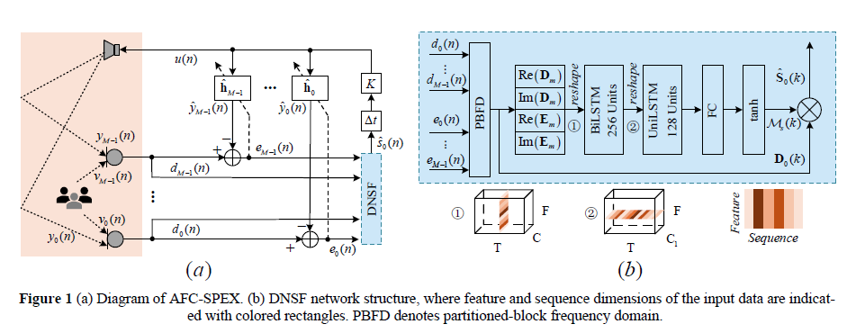

# AFC-SPEX · ICASSP 2026

[](https://ieeexplore.ieee.org/document/11464513)
[](https://ieeexplore.ieee.org/document/11464513)
[](LICENSE)

Official implementation of the **ICASSP 2026** paper:

**[Joint Multichannel Acoustic Feedback Cancellation and Speaker Extraction via Kalman Filter and Deep Non-Linear Spatial Filter](https://ieeexplore.ieee.org/document/11464513)**

## System Overview



AFC-SPEX combines **multichannel acoustic feedback cancellation (AFC)** with **target speaker extraction**. Kalman-filter-based AFC estimates and cancels the acoustic feedback at each microphone, while a deep non-linear spatial filter (DNSF) extracts the target speech using multichannel microphone signals and AFC residuals.

The figure shows (a) the AFC-SPEX system and (b) the DNSF network architecture.

## Repository Status

The teacher-forcing data generation scripts, along with the training and inference scripts for the proposed method, `afc_spex`, and the baseline, `ideal_afc_dnsf`, are publicly available.

## Dataset and Test Samples

The dataset and test samples are available from [Nanjing University Box](https://box.nju.edu.cn/d/cd07cf71914c4edfa128/).

- Password: `afcspex1014`
- Dataset archive: `prep.zip`

## Getting Started

1. Create the conda environment using `environment.yml`.
2. Download and extract `prep.zip` from the link above.
3. Check the configuration files in `configs/` before running experiments.
4. Use `train.py` for model training. Distributed training is supported.
5. Use `infer.py` for inference and closed-loop simulation.
6. Use `evaluate.py` to evaluate the results.

## Citation

If you find this repository useful, please cite our [ICASSP 2026 paper](https://ieeexplore.ieee.org/document/11464513).

```bibtex
@inproceedings{li2026afcspex,
  author    = {Li, Ze and Guo, Haocheng and Ge, Xiaoyang and Chen, Kai and Lu, Jing},
  title     = {Joint Multichannel Acoustic Feedback Cancellation and Speaker Extraction via Kalman Filter and Deep Non-Linear Spatial Filter},
  booktitle = {2026 IEEE International Conference on Acoustics, Speech and Signal Processing (ICASSP)},
  year      = {2026},
  doi       = {10.1109/ICASSP55912.2026.11464513},
  url       = {https://ieeexplore.ieee.org/document/11464513}
}
```

## Acknowledgements

The code framework is based on the excellent [SEtrain](https://github.com/Xiaobin-Rong/SEtrain) repository.
